# The economic question

## Governments offer access, costs and rights {#motivation .compact}

[Admission is one part of a package that shapes a person’s future options]{.subtitle}

:::: {.columns}
::: {.column width="49%"}
### Access to employment

- Occupation, citizenship and sponsorship can determine which routes a worker can use.
- Employer portability changes the jobs available **after admission**.
- A route opening can redirect workers from another destination rather than create a new move.
:::
::: {.column width="49%"}
### Residence and membership

- Family work rights, renewal and settlement change the value of the initial offer.
- Argentina’s investment-linked **citizenship** initiative illustrates a different membership instrument—not a work visa.
- Announced terms, binding rules and operational access are distinct.
:::
::::

[How do these offers change the allocation of workers—and the offers made by rival governments?]{.bg}

::: {.nav}
[Legal examples](#episodes){.button} [Nationality-specific routes](#preferences){.button}
:::

::: {.notes}
Substantive slide 1/15. Argentina: Decrees 366/2025 and 524/2025 establish category/procedure; 2 October 2026 announcement describes financial terms, not a verified exact application opening. The episode motivates a policy panel displayed through 2025, not an observation inside that window. The earlier UK examples are not reused with unverified historical thresholds. Germany’s exact occupation-targeted episode remains a lead requiring identification, not an asserted causal treatment.
:::

## How do governments respond to workers and rivals? {#question .compact}

[Worker substitution connects visa menus to competition for talent]{.subtitle}

### Government offers → worker choices and composition → rival offers

- **Worker side:** which terms affect participation, destination, employer choice and retention?
- **Government side:** do countries compete through fees, eligibility and rights?
- **Firm side:** how do recruitment, sponsorship and employer dependence affect wages and allocation?

[Which allocation and welfare consequences follow from a change in one country’s offer?]{.fg}

::: {.takeaway}
Measure menus and careers first. Estimate worker substitution, then add the decision problem of firms or governments.
:::

::: {.notes}
Substantive slide 2/15. Main question recovered from the PhD Review Visa brief and earlier Global Competition presentation. Descriptive questions do not all require elasticities; government/firm counterfactuals require additional objectives, constraints and equilibrium closure.
:::

## Connecting legal offers with global career allocation {#contribution .literature}

[Route-level policy bundles connect policy measurement with worker histories]{.subtitle}

- **Policy measurement and competition:** legal regimes select different migrants and compete for talent [@helblingMeasuringImmigrationPolicies2017; @dehaasGrowingRestrictivenessChanging2018; @czaikaGravityHighSkilledMigration2017; @shacharRaceTalentHighly2006].
  - **Our contribution:** a broad motive inventory and dated, work-oriented route bundles for comparable profiles.
- **International allocation:** alternatives, return migration and international careers matter [@bertoliMultilateralResistanceMigration2013; @brinattiThirdCountryEffectsUS2024; @amanzadehReturnMigrationHuman2024; @bhalothiaGlobalValueCities2025].
  - **Our contribution:** connect legal menus to domestic and international career transitions.
- **Legal options and labour markets:** access to migrant labour, employer restrictions and connected domestic markets shape firm and worker outcomes [@doranEffectsHighSkilledImmigration2022; @townsendHowRestrictingMigrants2025; @borusyakUnderstandingMigrationResponses2026].
  - **Our contribution:** cross-country legal-menu measurement, with competing government offers as a proposed extension.

::: {.nav}
[Full literature map](#literature-map){.button} [Demand identification](#demand-identification){.button} [Government objectives](#government-costs){.button}
:::

::: {.notes}
Substantive slide 3/15. Do not claim the first policy dataset, third-country response, or visa-induced employer-mobility result. Townsend–Allan concerns within-destination employer options and wage setting; Borusyak et al. domestic region–industry responses under specified shocks. Neither supplies a ready international coefficient or closure. The competing-government model remains a research extension. Cai–Lin–Szeidl is intentionally excluded from this presentation.
:::

# Data: offers and histories

## One Atlas, two layers: inventory and characteristics {#atlas .compact}

[The retained delivery distinguishes migration motives from detailed contract terms]{.subtitle}

:::: {.columns}
::: {.column width="47%"}
### Broad pathway inventory

**5,744 country/name entries · 194 destination labels**

Work, study, family, protection, business/investment, visit and other categories.

Search-window metadata: **2000–2025**.

This is a retained inventory, not certified exhaustive legal discovery.
:::
::: {.column width="51%"}
### Detailed annual characteristics

**2,195 country/route IDs · 43,049 route-years**

**80 value fields + 80 status fields**, with four identifying columns.

Work-oriented selection precedes detailed extraction. Native unit: **destination × route × year**.
:::
::::

Eligibility · financial burdens · procedures · employment rights · family rights · renewal and settlement

::: {.nav}
[Categories and fields](#atlas-categories){.button} [Identity and history](#atlas-history){.button}
:::

::: {.notes}
Substantive slide 4/15. Retained 25 October broad/annual CSV readback; 80 exact export value names equal status-companion bases and current schema definitions. The earlier “81” is not the current export count. Raw annual years 1940–2026 do not establish verified search coverage beyond 2000–2025. Missing/uncertain/inapplicable/known states remain distinct. Family/study routes may allow work; labels alone do not define rights. Category classification needs validation.
:::

## Revelio follows domestic and international job histories {#histories .compact}

[Foundation totals and transition samples are distinct constructions]{.subtitle}

| Full keyed foundation | Broad verified-geography events, 2010–2025 |
|:--|:--|
| **549.7 million** keyed people | **892.2 million** domestic transitions |
| **1.766 billion** positions | **83.65 million** international transitions |

### One person can contribute several different events

Domestic employer change → international job-country change → return or onward transition

- These are **career events**, not counts of visa grants or necessarily residential moves.
- The strict whole-history sample retains **303.5 million people**; its denominator differs from the broad sample above.

::: {.nav}
[Sample and chronology](#history-construction){.button} [Gaps and attrition](#history-gaps){.button} [Horizon outcomes](#horizon){.button}
:::

::: {.notes}
Substantive slide 5/15. Foundation 549,729,026 people/1,765,970,337 positions; strict 303,499,990 people/1,117,773,296 positions. Broad geography count 975,853,764 = 892,202,126 domestic + 83,651,638 international. Missing-country records are removed before ordering in this broad construction; ties are unresolved. Never combine it with strict counts as a single sample funnel. Positions are not completed job spells. A same-country job transition is not same-job staying.
:::

## Matching policies to careers requires comparable profiles {#bridge .compact}

[Legal eligibility and observed career characteristics are not the same object]{.subtitle}

| Dimension | Atlas and policy comparison | Revelio and analytical support |
|:--|:--|:--|
| **Time** | 2000–2025 presentation window | Verified transition comparison: 2010–2025 |
| **Occupation** | 22 nonmilitary SOC major groups | Finer O*NET codes retained; SOC major groups used here |
| **Origin** | Citizenship/residence conditions | Prior recorded job country—not citizenship |
| **Education** | Route-specific requirements | Lifetime highest degree need not precede a move |

Passing occupation and education screens is **partial compatibility**, not complete admission eligibility.

::: {.nav}
[All occupational levels](#taxonomy){.button} [Coverage](#represented){.button} [Unresolved rules](#unresolved){.button}
:::

::: {.notes}
Substantive slide 6/15. Official reference hierarchy: 23/98/459/867 major/minor/broad/detailed codes, not measured provider cardinalities. Source support includes military; Atlas grid excludes it. Earlier 11-skilled-group and current four-group gravity restrictions are analytical selections. Complete native vendor hierarchy, fine observed counts and source vintage remain unverified. Salary, sponsor, age, experience and family circumstances can remain unresolved in a putative profile match.
:::

# Three descriptive facts

## Recorded active pathways increase over time {#pathway-growth .visual}

[Work-oriented route IDs · 2000–2025 · 744 → 1,965]{.subtitle}

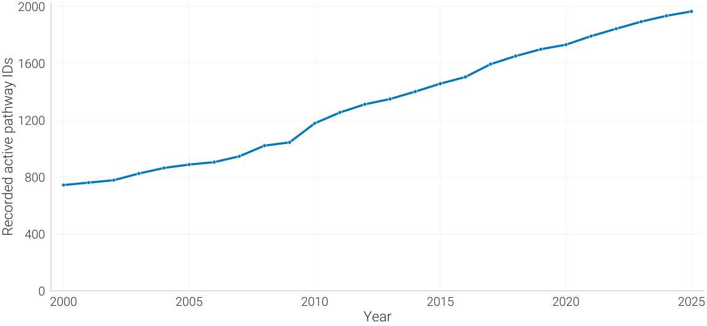{.exhibit}

::: {.nav}
[Country representation](#represented){.button} [Appearances and endings](#turnover){.button}
:::

::: {.notes}
Substantive slide 7/15. Source results/monetary/annual_recorded_turnover.csv; count IDs, not legal grants or exhaustive applicant menus. Wider represented support, renamings and constructed histories can affect counts. First representation is not necessarily policy adoption. The next slide holds destination/profile support fixed.
:::

## Recorded screen passes increase on fixed support {#pooled-menu .visual}

[Fixed destination–profile support · equal cell weights · six dates]{.subtitle}

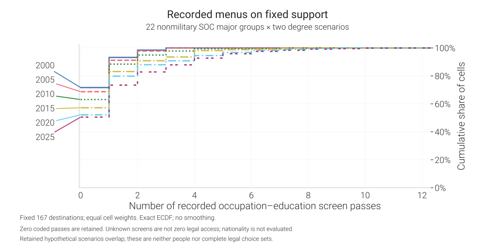{.exhibit}

::: {.nav}
[Changing support](#pooled-changing){.button} [Computer/math example](#profile-computer){.button} [Healthcare example](#profile-health){.button}
:::

::: {.notes}
Substantive slide 8/15. Retained represented_destination_profiles.csv. Mean coded passes 0.366494/0.422836/0.576483/0.794502/1.012520/1.222646 in 2000/05/10/15/20/25. Zero shares 71.6658% to 50.5171%; median remains zero. Equal cells are not population weights and under/postgraduate scenarios overlap. Known zero passes require represented active records; absent destinations are not coded zero. No nationality/age screen is applied; unresolved is not legal exclusion. The result is average recorded partial-screen expansion, not first-order dominance or universal access.
:::

## Employer sponsorship remains common as its recorded share falls {#screening .visual}

[2000–2025 · four occupation profiles · undergraduate screen · resolved sponsorship]{.subtitle}

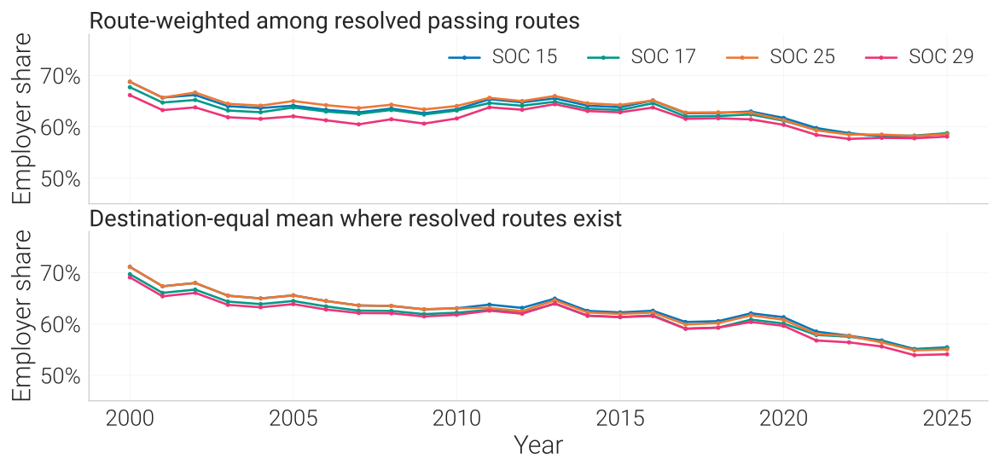{.exhibit}

::: {.nav}
[Weights](#sponsorship-weights){.button} [Education rules](#education-rules){.button} [Family rights](#spouse-rights){.button} [Fee contrasts](#fee-contrasts){.button}
:::

::: {.notes}
Substantive slide 9/15. Actual retained annual-sponsorship summaries, not a new restriction index. Near-overlap across these occupation profiles is informative; do not claim large occupational differentiation from this graph. Shares are conditional on screen-passing routes and resolved sponsorship; unknown does not mean no sponsor. Route-weighted and destination-equal shares answer different questions. This documents a particular instrument, not that all countries change every instrument in the same way.
:::

## A profile can face different joint requirement bundles {#bundles .compact}

[Czechia, 2024 · SOC 15 undergraduate screen · three of 12 passing route IDs]{.subtitle}

| Recorded route | Sponsor | Applicant fee | Annual salary floor | Nationality condition |
|:--|:--|:--|:--|:--|
| Digital Nomad Visa | None | CZK 2,500 | CZK 780,144 | AU, CA, GB, JP, KR, NZ, TW, US |
| Employee Card | Employer | CZK 7,500 | CZK 226,800 | No recorded gate |
| EU Blue Card | Employer | CZK 5,000 | CZK 780,138 | Unknown |

- Each row is an **actual recorded package**, not independent field minima.
- Occupation/education compatibility is not complete eligibility for one person.
- Nationality, admission risk and continuation rights prevent an unqualified dominance claim.

::: {.nav}
[Dominance test](#dominance){.button} [Preferential routes](#preferences){.button}
:::

::: {.notes}
Substantive slide 10/15. Source results/monetary/joint-pathway-fees/czech_2024_soc15_undergraduate_routes.csv. Preserve raw source currency and annual salary period. Do not call the two 780,1xx values identical or independently verified law. Broad SOC mapping does not establish individual exact occupation eligibility. A no-recorded-gate field is not independently proven universal nationality access.
:::

## International transitions between regions {#group-transitions .visual .matrix}

[Broad verified-country events · 2010–2025 · diagonal: different countries in the same region]{.subtitle}

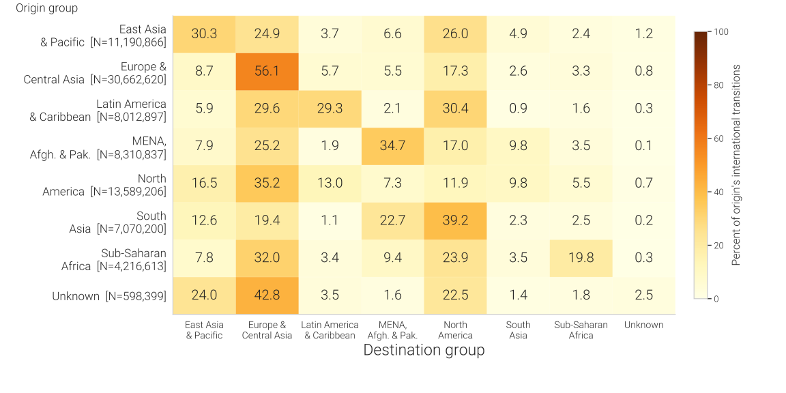{.exhibit}

::: {.nav}
[Region counts](#region-counts){.button} [Income-group transitions](#income-shares){.button} [Income counts](#income-counts){.button}
:::

::: {.notes}
Substantive slide 11/15. The broad verified-country adjacency sample contains 83,651,638 international job transitions in 2010–2025. Regions use fixed World Bank 2026 metadata; income groups use fixed FY2011 classifications. Unknown groups are retained. These are joint origin/destination event counts, not destination marginals. A diagonal is an international transition between different countries in the same region; domestic job transitions are excluded. Origin-conditional shares sum over destination groups. Income-group transitions describe country environments, not personal wage gains.
:::

## International transitions between occupational families {#occupation-transitions .visual .matrix}

[Strict-history international events · 2010–2025 · occupational families, not a skill ladder]{.subtitle}

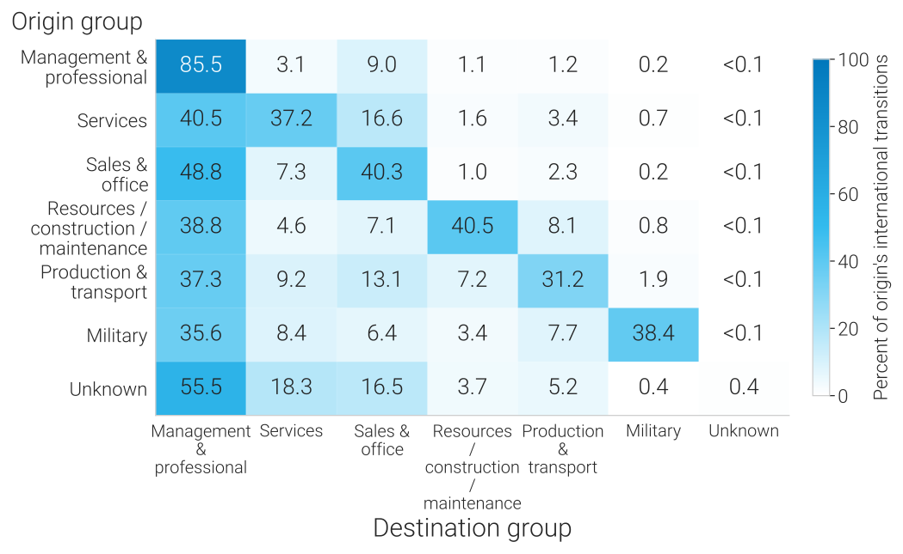{.exhibit}

::: {.nav}
[Family counts](#family-counts){.button} [All 23 SOC groups](#occupation-detail){.button} [Domestic comparison](#occupation-switching){.button} [Skill/task interpretation](#skills){.button}
:::

::: {.notes}
Substantive slide 12/15. Six analytical families plus unknown: SOC11–29 management/business/science/arts (including education/legal/healthcare);31–39services;41/43sales/office;45/47/49naturalresources/construction/maintenance;51/53production/transport;55military. Mapping exhausts23major groups and both margins reconcile with full joint counts. Family changes14542762/55618521=26.14734% among known-code events. This is NOT55.19646%SOC2 switching; broad families consolidate many SOC2 moves. Full joint matrix retains113932unknownendpoint events for55732453international events. DomesticSOC2 switch335730244/623487006=53.84719%;countryunresolved7324outsideboth. Repeated events, not distinct people. No rank or upgrading inference.
:::

# Worker responses and policy incentives

## Workers choose among the pathways they can access {#worker-demand .compact}

[A random-utility model separates fixed geography from government-chosen offers]{.subtitle}

$$
u_{ijt}=\alpha\log\widetilde w_{ijt}
+\underbrace{\color{#0077BB}{\beta' z_{od}}}_{\text{fixed geography}}
+\underbrace{\color{#EE7733}{\gamma' q_{jt}}}_{\text{chosen visa terms}}
+\xi_{jt}+\varepsilon_{ijt},\qquad j=(d,v).
$$

$$
p_{ijt}(C_{it})=
\frac{\mathbf 1\{j\in C_{it}(r_t)\}\exp(V_{ijt})}
{\sum_{k\in C_{it}(r_t)}\exp(V_{ikt})}.
$$

- **Net wage** $\widetilde w$: earnings net of taxes and annualised application charges.
- $z$: distance and other fixed geography; $q$: rights and portability; $r$: eligibility rules.
- $C_{it}(r_t)$ includes staying and the worker’s accessible pathways.

Migration RUMs and destination substitution: [@kennanEffectExpectedIncome2011; @bertoliMultilateralResistanceMigration2013].

::: {.nav}
[Denominators and MPML](#mpml){.button} [Fixed effects](#fixed-effects){.button} [Preference versus access](#demand-identification){.button}
:::

::: {.notes}
Substantive slide 13/15. Illustrative static RUM, not an adopted or estimated individual likelihood. Worker i starts in origin o; j=(destination d, pathway v); t is time. V is utility excluding the idiosyncratic shock. Conditional logit requires iid type-I extreme-value shocks conditional on the relevant set and observables. Staying is normalised as alternative0 with its own utility, not assigned a foreign visa. Net earnings must be positive for the log; fees are annualised or converted to a common consumption horizon, not subtracted as a lump sum from an annual flow without conversion. Fixed distance is treated as predetermined in this model, not an instrument for every policy. q includes portability, duration and family rights; r sets eligibility and affects C. Actual access can also depend on sponsorship, admission and information. Legal compatibility is not complete access. Revelio normally reveals destination job country, not visa route: route probabilities must be aggregated over v before matching country flows. Dynamic migration RUMs are precedents, not this static formula verbatim. ξ is unobserved destination/pathway attractiveness. Wages/net fees and chosen characteristics may respond to it.
:::

## Estimation must separate preferences from access {#cost-preliminaries .compact}

[Gravity connects individual choices to flows; zeros alone do not reveal why an option is absent]{.subtitle}

$$
\mu_{odt}=N_{ot}\sum_v \mathbb E[p_{i,dv,t}(C_{it})\mid o,t].
$$

**Two endogenous margins:** $\widetilde w_{ijt}$ and $q_{jt}$ may covary with $\xi_{jt}$; the accessible set $C_{it}$ is partly unobserved.

- **Offers:** demand inversion and instruments [@berryNonparametricIdentificationDifferentiated2024].
- **Access:** latent or restricted choice sets [@agarwalDemandAnalysisLatent2025; @almagroChoicesConstraintsDisentangling2026].
- **Information:** revealed-preference bounds [@porcherMeasuringInformationFrictions2025].

::: {.nav}
[Fixed effects and samples](#fixed-effects){.button} [Monetary comparability](#monetary){.button} [Government costs](#government-costs){.button}
:::

::: {.notes}
Substantive slide14/15. No current gravity estimates are presented. N_ot is the origin population at risk and μ is expected flow; expectation averages worker heterogeneity and accessible sets. The expression is an aggregation identity conditional on the illustrative choice model, not a claim that a generic heterogeneous RUM reduces to a linear PPML index. Standard logit/gravity restrictions can supply an aggregate starting point. A zero observed cell can reflect an unavailable route, an unaffordable offer, low preferences, a finite-sample zero or measurement/coverage; never classify every zero as selection. Even positive flows face endogenous characteristics: governments choose rules and rights in response to latent attractiveness/composition, while firms and governments affect wages or net charges. These are distinct from predetermined geography. Destination-time and dyad fixed effects can absorb policy or distance, respectively, rather than identify them automatically. PPML handles count zeros but does not by itself identify unavailable alternatives. Berry–Haile supplies conditional identification/instrument restrictions; Agarwal–Somaini addresses latent choice constraints; Almagro–Sood is a housing comparator with its own set restrictions; Porcher etal separates information frictions and preferences through revealed-preference bounds. These are candidate routes, not an already solved estimator for visa data.
:::

## Demand elasticities connect design, costs and welfare {#next-steps .compact}

[The same demand estimates can discipline a firm model or a government model]{.subtitle}

$$
D(a;\widehat\eta),\qquad
\max_{a_d}\;R_d(a,D)+B_d(D)-C_d(a_d,D),
\qquad a_d=(f_d,q_d,r_d).
$$

- **Demand + supply conditions** → restrictions on marginal costs and incentives.
- **New design:** a portable work visa replaces employer-tied permission.
- **Counterfactuals:** who applies, how firms and rivals respond, and who gains?

[Demand elasticities are the common input; objectives and equilibrium determine the welfare exercise.]{.fg}

::: {.nav}
[Government cost inversion](#government-costs){.button} [Welfare scope](#welfare){.button} [All references](#references){.button}
:::

::: {.notes}
Substantive slide15/15. Proposed research sequence, not completed cost or welfare estimates. η denotes worker demand parameters/elasticities; a_d is a country or provider's fee, characteristics and eligibility menu. R is revenue, B other benefits/objective terms and C resource or implementation cost; their arguments and ownership differ for firms and governments. Continuous interior characteristics may yield first-order restrictions; discrete eligibility rules, quotas and political/legal constraints may instead require inequalities or discrete deviations. Demand alone cannot separately identify unrestricted B and C; recover costs only with objectives, market conduct, constraints and parameterisation explicitly specified. Distinguish characteristic marginal costs from fees paid by applicants and from marginal cost per entrant. For a portable visa compare fixed rival offers first, then endogenous firm/wage and government responses under an explicit equilibrium. Welfare includes workers/families, origin and destination residents, firms and fiscal effects; fees are transfers, future rights and participation matter. A demand estimate need not identify welfare without those primitives and population scope. Trade-policy inversion is a methodological comparison, not an identification theorem for visas.
:::

# Appendix: legal objects and data

## Admission, residence and citizenship are distinct {#episodes .compact}

| Example | Institutional distinction | Presentation scope |
|:--|:--|:--|
| Argentina investment-linked citizenship | 2025 decrees create category/procedure; October 2026 announcement describes financial/family terms. | Citizenship, not a work visa. Exact operational opening not established. |
| Citizenship-conditioned work access | A potential migrant’s nationality can determine a preferential route. | Previous job country cannot assign nationality. |
| Employer-tied work permission | Admission may leave the holder dependent on a sponsor. | Portability and continuation can matter without an immediate move. |

The US H-1B1 comparison and Germany’s Western Balkans employment regulation provide source-backed nationality examples; they are not a verified identification of the separately mentioned recent German occupation-specific announcement.

::: {.nav}
[Return: motivation](#motivation){.button}
:::

## A nationality preference need not dominate a general route {#preferences}

- H-1B1 for Chile/Singapore has nationality-specific allocations and a distinct visa-abroad procedure.
- Temporary-intent and duration/renewal terms differ from the ordinary H-1B framework.
- Germany’s Western Balkans route illustrates nationality-conditioned access with different qualification rules.

**Compare the whole bundle for the same applicant and date:** eligibility, sponsor, fees, intent, work rights and continuation.

::: {.nav}
[Return: motivation](#motivation){.button} [Return: route bundles](#bundles){.button}
:::

::: {.notes}
Existing official-source comparisons in docs/research/origin-specific-mobility-arrangements.md and atlas-origin-specific-coverage.md. Do not treat retained Atlas duration fields as independently verified legal rules; the H-1B1 source/panel duration mismatch remains documented. No empirical policy treatment is assigned from these illustrations.
:::

## The broad inventory includes more than work routes {#atlas-categories .compact}

:::: {.columns}
::: {.column width="45%"}
| Retained category code | Entries |
|:--|--:|
| Work | 1,480 |
| Study | 446 |
| Family | 571 |
| Protection | 576 |
| Business/investment | 579 |
| Visit | 669 |
| Other | 1,423 |
| **Total** | **5,744** |
:::
::: {.column width="51%"}
### Characteristic families

- Access and selection
- Fees, funds, salary and investment
- Procedures and compliance
- Work rights and portability
- Family and dependent rights
- Duration, renewal and settlement
- Identity, status and timing
:::
::::

The detailed release has **80 values and 80 status companions**, not 80 independent screening instruments. A separate AI-category field is blank in 3,693 inventory entries.

::: {.nav}
[Return: Atlas](#atlas){.button}
:::

## Route identity and annual history require validation {#atlas-history}

- ID: country plus supplied/slugified route name—not an adjudicated legal equivalence class.
- Annual states use lifecycle bounds, recorded changes and forward-filling; they are not independent annual legal observations.
- Renaming, branching and succession can change counts without adding a simultaneous option.
- Unknown, inapplicable, uncertain and known values must remain distinct.

**Raw annual years: 1940–2026; intended search/display window: 2000–2025.** The UK has only two IDs in the unchanged 2024 retained panel, a consequential coverage warning.

::: {.nav}
[Return: Atlas](#atlas){.button} [Return: growth](#pathway-growth){.button}
:::

## Occupational detail and analytical restrictions differ {#taxonomy .compact}

| Level or selection | Count/scope | Interpretation |
|:--|:--|:--|
| Official SOC major/minor/broad/detailed | 23 / 98 / 459 / 867 | Reference taxonomy, not observed vendor counts |
| Atlas major-group scenarios | 22 | Military excluded; national classifications mapped into SOC |
| Earlier skilled-group analysis | 11 | Analytical restriction |
| Current monetary gravity | 15, 17, 25, 29 | Four selected major groups |
| Retained Revelio source | O*NET code; older `role_k1500` fallback | Fine counts, complete vendor hierarchy and edition unverified |

The observed occupation source includes military and malformed values. Exact recognized-code rules differ from simply taking two initial characters.

::: {.nav}
[Return: bridge](#bridge){.button} [Return: occupations](#occupation-transitions){.button}
:::

## History construction changes the retained population {#history-construction .compact}

| Object | People | Positions/events |
|:--|--:|--:|
| Full keyed foundation | 549,729,026 | 1,765,970,337 positions |
| Strict whole histories | 303,499,990 | 1,117,773,296 positions |
| Strict adjacent events, all retained years | — | 814,273,306 events |
| Broad verified geography, 2010–2025 | — | 975,853,764 events |

Missing starts, countries and tied starts have **overlapping** exclusion counts. The strict rule excludes a person if any history record fails; the broad geography construction removes missing-country records before ordering.

These are different populations, not successive rows in one funnel. Concurrent positions, missing ends and chronology cannot be resolved by arbitrary sorting.

::: {.nav}
[Return: histories](#histories){.button}
:::

## Many positive gaps are short; missing updates still matter {#history-gaps .visual}

[Measured positive adjacent-record gaps · not unemployment or legal-status gaps]{.subtitle}

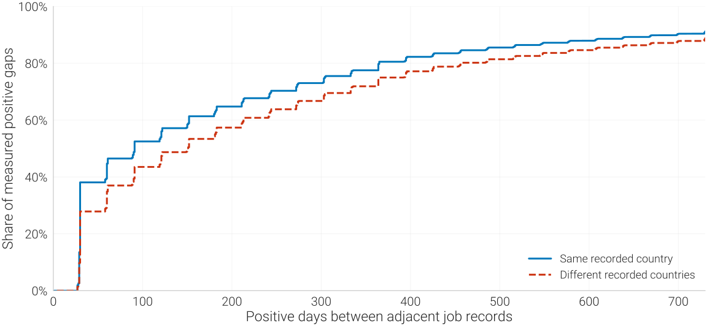{.exhibit}

::: {.nav}
[Return: histories](#histories){.button}
:::

## A fixed horizon requires a job covering the endpoint {#horizon .visual}

[Corrected one-year endpoint comparison · unresolved follow-up is separate]{.subtitle}

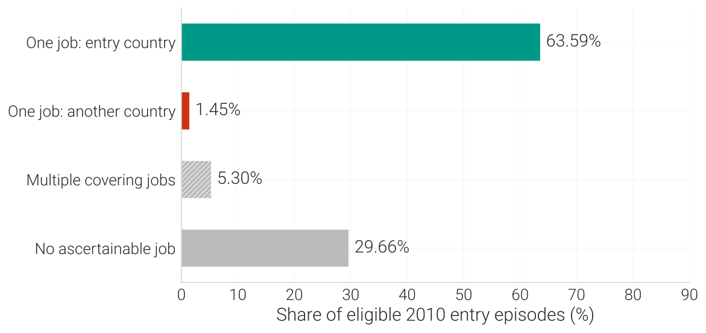{.exhibit}

::: {.nav}
[Return: histories](#histories){.button}
:::

## Historical representation broadens over time {#represented .visual}

[Represented destination labels · not necessarily new policy adopters]{.subtitle}

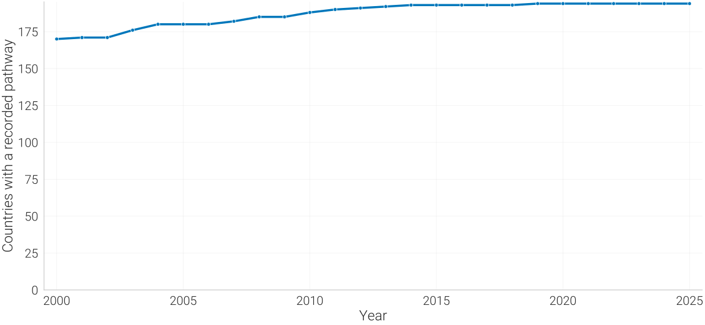{.exhibit}

::: {.nav}
[Return: growth](#pathway-growth){.button} [Return: bridge](#bridge){.button}
:::

## Recorded appearances and endings are not legal births and deaths {#turnover .visual}

[The 2000 boundary and unresolved status affect lifecycle interpretation]{.subtitle}

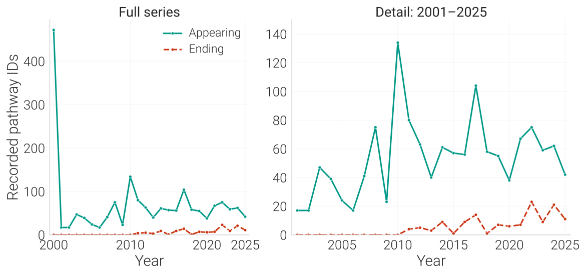{.exhibit}

::: {.nav}
[Return: growth](#pathway-growth){.button}
:::

## Changing support gives a different pooled comparison {#pooled-changing .visual}

[Changing destination support · occupation–education scenarios · six dates]{.subtitle}

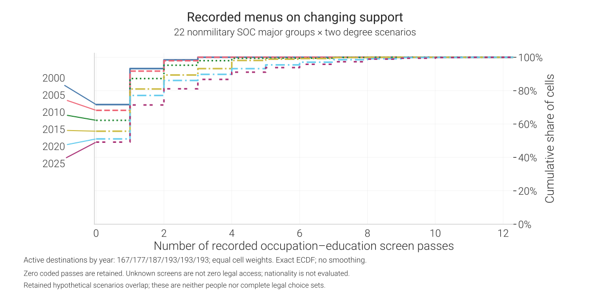{.exhibit}

::: {.nav}
[Return: fixed-support result](#pooled-menu){.button}
:::

## Computer/mathematical profile: fixed-support comparison {#profile-computer .visual}

[SOC 15 · undergraduate screen · six dates · no nationality or age screen]{.subtitle}

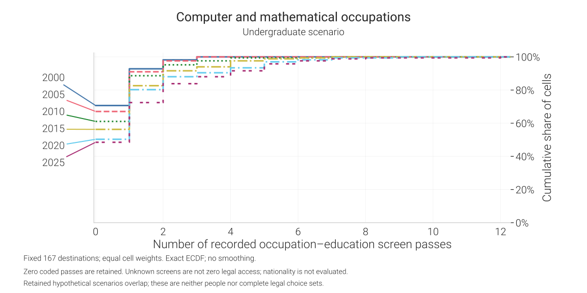{.exhibit}

::: {.nav}
[Return: pooled profiles](#pooled-menu){.button}
:::

## Healthcare-practitioner profile: fixed-support comparison {#profile-health .visual}

[SOC 29 · undergraduate screen · six dates · no nationality or age screen]{.subtitle}

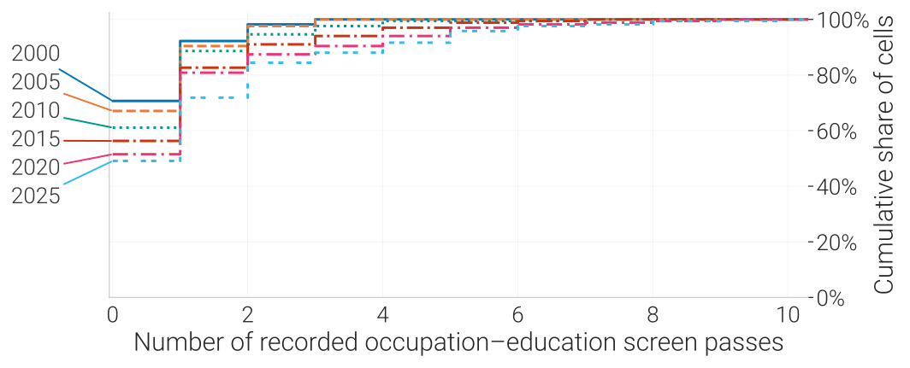{.exhibit}

::: {.nav}
[Return: pooled profiles](#pooled-menu){.button}
:::

## Unresolved rules prevent a complete legal-menu interpretation {#unresolved .visual}

[Recorded pass counts and unresolved evaluations are different objects]{.subtitle}

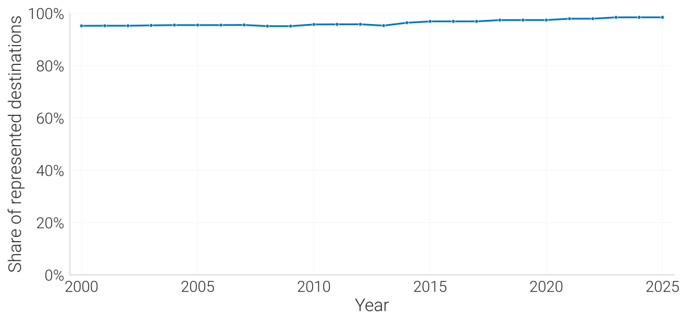{.exhibit}

::: {.nav}
[Return: bridge](#bridge){.button} [Return: pooled profiles](#pooled-menu){.button}
:::

## Credential requirements are often unresolved {#education-rules .visual}

[2000–2025 · represented route records · not an ordinal route-skill ranking]{.subtitle}

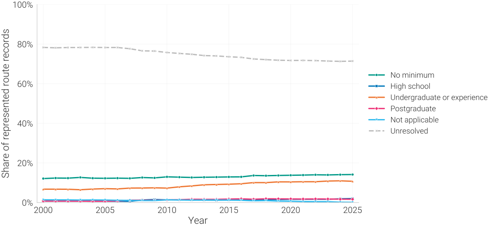{.exhibit}

::: {.nav}
[Return: screening](#screening){.button}
:::

## Sponsorship shares depend on the weighting rule {#sponsorship-weights .visual}

[2024 · route-weighted, destination-equal and median comparisons]{.subtitle}

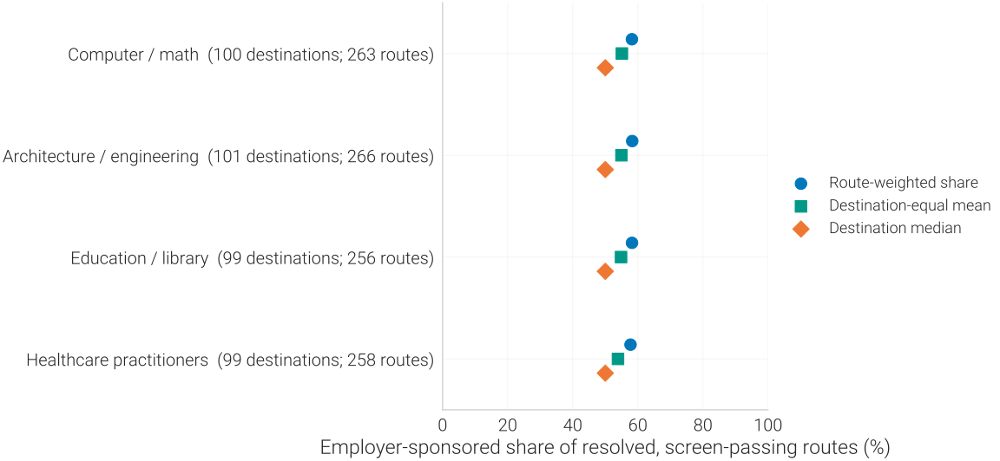{.exhibit}

::: {.nav}
[Return: screening](#screening){.button}
:::

## Spouse work rights are one part of the route bundle {#spouse-rights .visual}

[Represented route records · not an active-only or applicant-weighted denominator]{.subtitle}

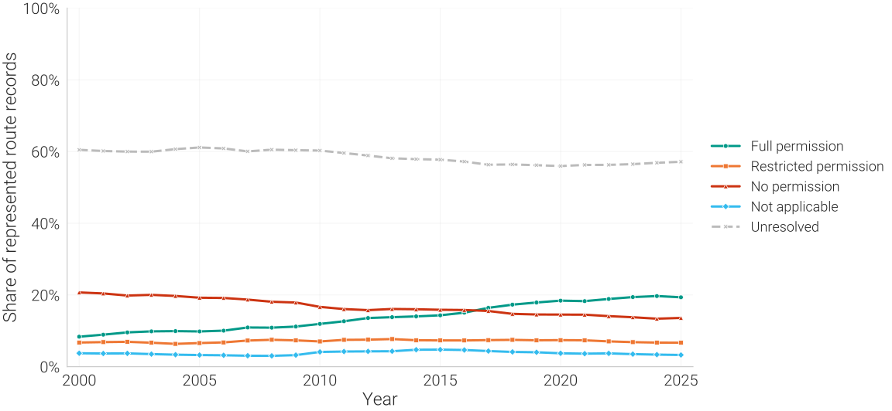{.exhibit}

::: {.nav}
[Dependent access](#dependent-rights){.button} [Return: screening](#screening){.button}
:::

## Dependent access and dependent work rights are distinct {#dependent-rights .visual}

[Represented route records · preserve unknown and inapplicable states]{.subtitle}

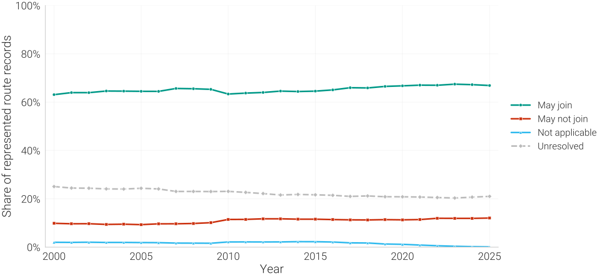{.exhibit}

::: {.nav}
[Return: family-rights comparison](#spouse-rights){.button} [Return: screening](#screening){.button}
:::

## Joint fee contrasts keep comparisons within a profile cell {#fee-contrasts .visual}

[SOC 15 · employer-sponsored minus explicit-none routes · comparable applicant fees]{.subtitle}

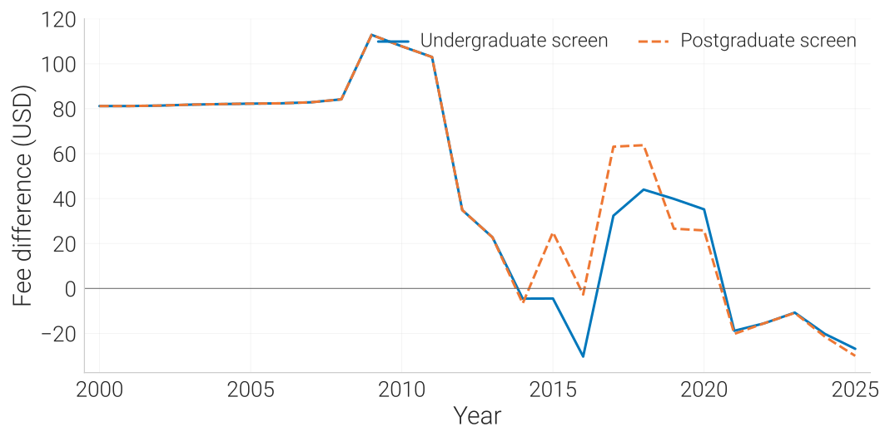{.exhibit}

::: {.nav}
[Return: screening](#screening){.button}
:::

::: {.notes}
Nominal USD, overlapping degree profiles and changing comparable-cell composition. No supported employer-fee contrast exists. Do not infer causality or an employer-sponsorship premium from these descriptive differences.
:::

## Dominance needs complete, comparable bundles for one applicant {#dominance}

For declared dimensions, route A weakly dominates B only if A is weakly preferred on every dimension and strictly preferred on at least one.

- Fix citizenship, occupation, education, destination, year and application stage.
- Compare actual joint terms—not a synthetic combination of minima.
- Confirm the preference direction: a salary threshold is not a promised wage.
- Keep admission risk, sponsor availability, future rights and missing terms visible.

**Report:** dominated on observed dimensions; incomparable; or unassessable. Absence of observed dominance is not complete economic nondominance.

::: {.nav}
[Return: bundles](#bundles){.button}
:::

# Appendix: group-to-group mobility

## Region-to-region international transition volumes {#region-counts .visual}

[2010–2025 · fixed World Bank 2026 regions · repeated international events]{.subtitle}

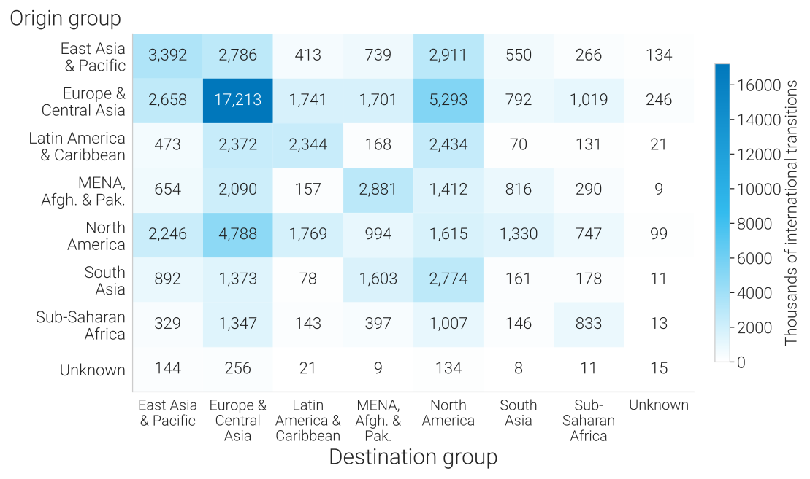{.exhibit}

::: {.nav}
[Return: origin-conditional shares](#group-transitions){.button}
:::

## International transitions between income groups {#income-shares .visual .matrix}

[2010–2025 · fixed World Bank FY2011 income groups · origin-conditional shares]{.subtitle}

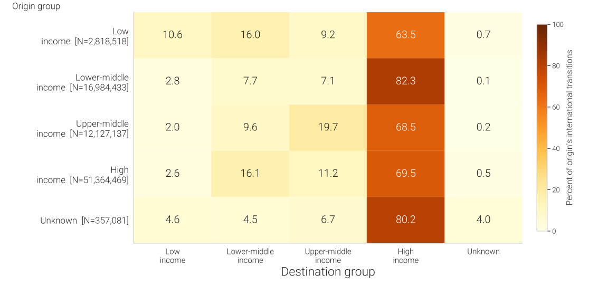{.exhibit}

::: {.nav}
[Counts](#income-counts){.button} [Return: regional transitions](#group-transitions){.button}
:::

## Income-group transition volumes reflect origin size too {#income-counts .visual}

[2010–2025 · fixed World Bank FY2011 groups · country income, not personal wages]{.subtitle}

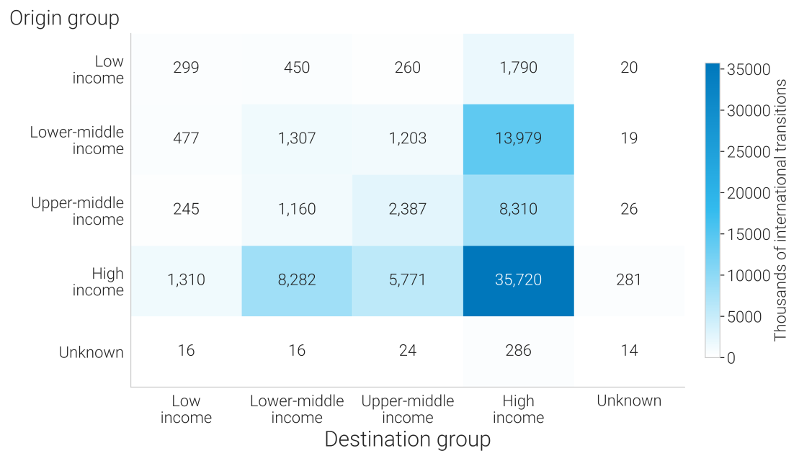{.exhibit}

::: {.nav}
[Income shares](#income-shares){.button} [Return: regional transitions](#group-transitions){.button}
:::

## Origin-to-destination occupation volumes {#occupation-counts .visual}

[Recognised SOC major groups · international events · no ordinal skill interpretation]{.subtitle}

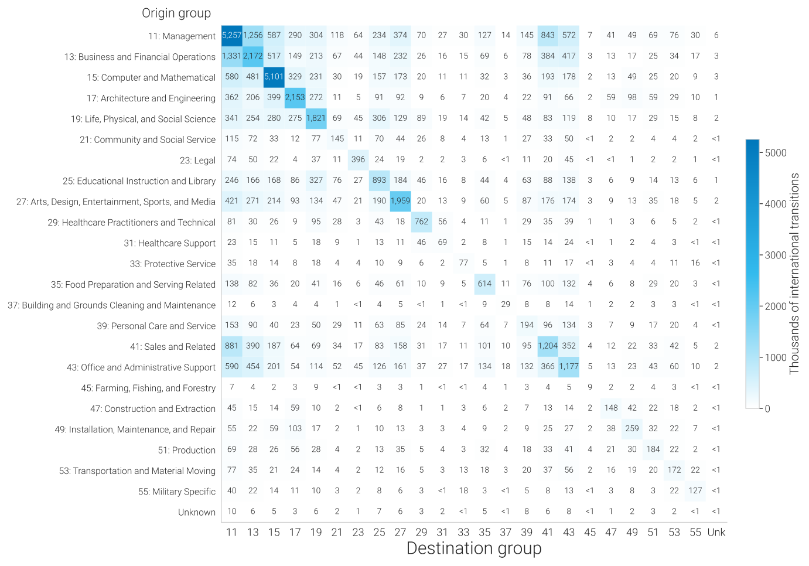{.exhibit}

::: {.nav}
[Detailed occupation shares](#occupation-detail){.button} [Return: occupational families](#occupation-transitions){.button}
:::

## Broad occupational-family transition volumes {#family-counts .visual}

[Six analytical families plus unknown · repeated international events]{.subtitle}

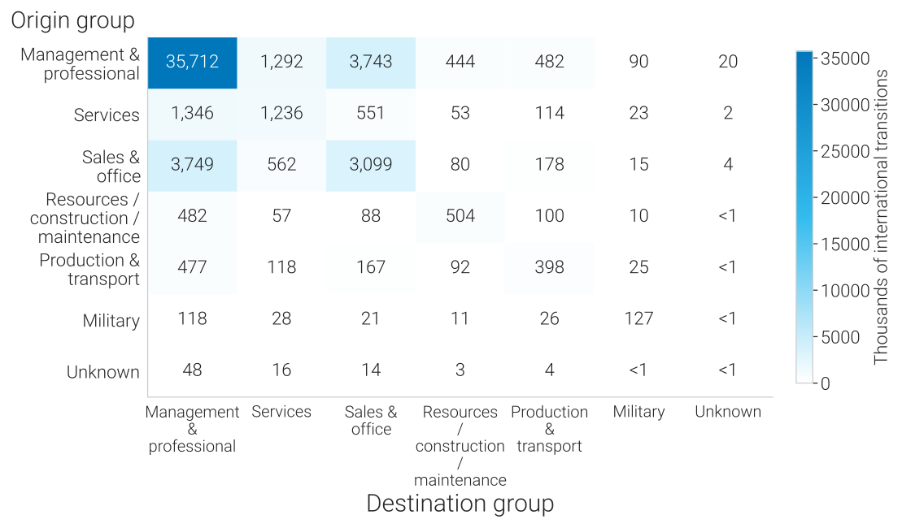{.exhibit}

::: {.nav}
[Return: family shares](#occupation-transitions){.button} [Detailed SOC counts](#occupation-counts){.button}
:::

## The full matrix retains every SOC major group {#occupation-detail .visual}

[23 groups plus unknown · origin-conditional shares · detail for discussion and zoom]{.subtitle}

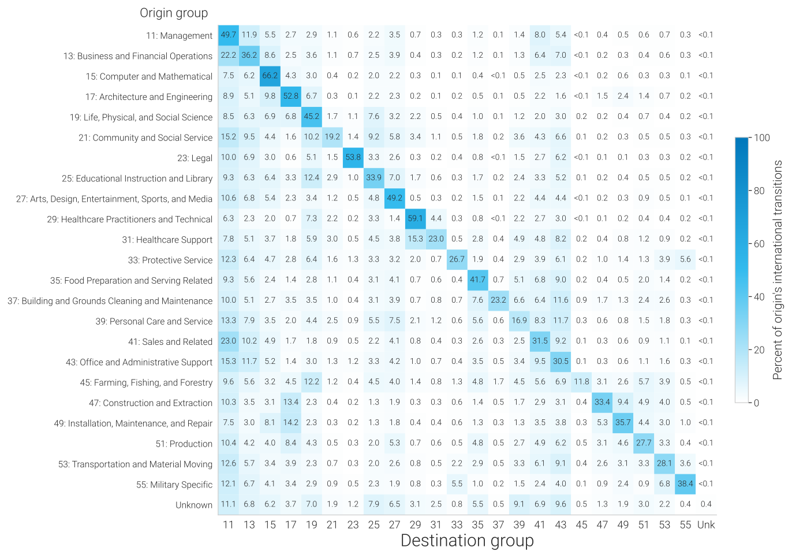{.exhibit}

::: {.nav}
[Detailed counts](#occupation-counts){.button} [Return: occupational families](#occupation-transitions){.button}
:::

## Switching occurs in domestic and international job transitions {#occupation-switching .visual}

[2010–2025 · recognised full occupation codes · event-weighted]{.subtitle}

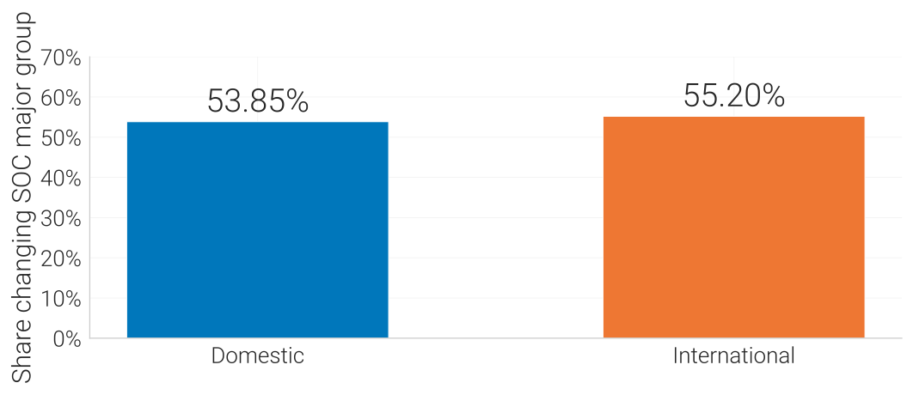{.exhibit}

::: {.nav}
[Return: occupational transitions](#occupation-transitions){.button}
:::

## Occupational groups are not a skill ladder {#skills}

- SOC major groups describe kinds of work; their numeric codes are not ranks.
- The broad SOC-to-ISCO reference scenario permits upward, downward and equal changes for about **95%** of events.
- Routine/non-routine, cognitive/manual and preparation requirements are distinct concepts.
- A defensible skill-transition matrix needs a verified finer code/vintage and a declared crosswalk; it cannot be recovered from destination skill marginals.

[The occupation matrix is descriptive evidence. A ranked skill matrix is not yet established.]{.fg}

::: {.nav}
[Return: occupational transitions](#occupation-transitions){.button} [Taxonomy](#taxonomy){.button}
:::

# Appendix: estimation and literature

## MPML normalises the supplied alternatives, not a missing population {#mpml}

$$
\mu_{ra}=\exp(\alpha_r+\beta x_{ra}+z_{ra}'\gamma),\quad
p_{ra}=\frac{\exp(\beta x_{ra}+z_{ra}'\gamma)}{\sum_{b\in A_r}\exp(\beta x_{rb}+z_{rb}'\gamma)}.
$$

$$\ell(\beta,\gamma)=\sum_{r,a}Y_{ra}\log p_{ra}.$$

- Profiling the row effect gives the corresponding Poisson objective on **identical support and weights**.
- Current $A_r$ contains observed positive, policy-matched international cells.
- Fitting supplied row totals does not recover unobserved stayers or unavailable destinations.

::: {.nav}
[Return: worker responses](#worker-demand){.button}
:::

## Fixed effects determine the monetary comparison {#fixed-effects .compact}

| Specification | Conditional row | Additional fixed effects |
|:--|:--|:--|
| L | Origin × year | Destination; occupation × education × year; dyad |
| D | Origin × year | Destination × year; occupation × education × year; dyad |
| T | Origin × occupation × education × year | Destination × year; dyad × occupation |
| K/E | Type-specific origins | Destination × occupation(× education) × year; dyad × occupation |

K/E absorb the monetary policy variation: **not identified**, not an estimated zero effect.

The estimand and fixed effects must leave the relevant policy variation. Dyad effects absorb fixed distance; destination-time effects absorb destination-wide offers. Neither automatically resolves individual access restrictions.

::: {.nav}
[Return: worker responses](#worker-demand){.button} [Return: monetary preliminaries](#cost-preliminaries){.button}
:::

## Monetary comparisons need compatible amounts and units {#monetary .visual}

[FX support is not proof of fee definition, real value or incidence]{.subtitle}

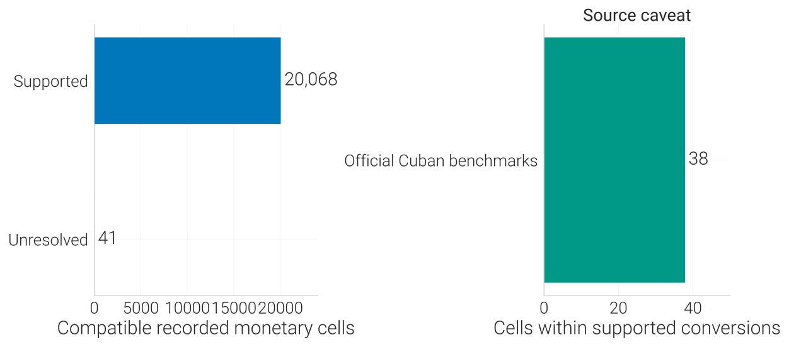{.exhibit}

::: {.nav}
[Return: monetary preliminaries](#cost-preliminaries){.button}
:::

## Rich histories do not by themselves separate preferences from access {#demand-identification}

[@berryNonparametricIdentificationDifferentiated2024; @agarwalDemandAnalysisLatent2025]

- Legal compatibility, consideration, sponsorship, admission and take-up are distinct stages.
- Observed characteristics and repeated choices add information; they do not eliminate market-level unobservables or supply excluded variation automatically.
- Applications, refusals, route-linked admissions and usable offers can help distinguish these stages.

**Our task:** define the choice occasion, population, support and policy variation before treating conditional allocation slopes as migrant elasticities.

::: {.nav}
[Return: contribution](#contribution){.button} [Return: worker responses](#worker-demand){.button}
:::

## Fee competition identifies a net marginal object {#government-costs .compact}

$$
G_d=f_d'n_d(f)+B_d(n_d)-C_d(n_d),\qquad
c_d-b_d=f_d+(D_d^{\mathsf T})^{-1}n_d.
$$

$D_d$ is the own-route quantity-by-fee derivative matrix; $b_d$ and $c_d$ are marginal benefits and resource costs.

- Requires identified unilateral fee responses, matching fee/quantity units, interior optimality and no omitted binding constraint.
- Capacity adds a multiplier; application fees need application-stage revenue.
- Adding the same function to $B_d$ and $C_d$ leaves choices unchanged: unrestricted benefits and costs are **not separately identified**.

Trade-policy inversion provides a comparison, not a Visa identification theorem [@adaoWorldTradingSystem2025].

::: {.nav}
[Return: cost preliminaries](#cost-preliminaries){.button} [Return: next steps](#next-steps){.button}
:::

## Welfare needs a population and an adjustment mechanism {#welfare}

- Migrants and families; origin residents; destination residents; employers; governments.
- Wages, amenities, fiscal effects and housing or other prices may adjust.
- Fees are transfers, waiting uses time, and restrictions can remove future options.
- Government recruitment gains do not establish gains for everyone affected.

**Counterfactual scope:** worker responses at fixed offers → market adjustment → government responses, adding assumptions at each step.

::: {.nav}
[Return: next steps](#next-steps){.button}
:::

## Policy measurement and allocation frame the contribution {#literature-map .literature .literature-detail}

[Previous findings and the contribution to each literature]{.subtitle}

- **Policy measurement:** levels, signed changes and instrument indicators have different units [@helblingMeasuringImmigrationPolicies2017; @dehaasGrowingRestrictivenessChanging2018; @czaikaGravityHighSkilledMigration2017].
  - **Our contribution:** dated route bundles and comparable occupation–education profiles.
- **Alternative destinations:** multilateral resistance and third-country diversion already have direct treatments [@bertoliMultilateralResistanceMigration2013; @brinattiThirdCountryEffectsUS2024].
  - **Our contribution:** connect changing legal menus to domestic and international careers.
- **Careers and equilibrium:** dynamic location choice; employer options and wage setting; connected domestic markets [@kennanEffectExpectedIncome2011; @townsendHowRestrictingMigrants2025; @borusyakUnderstandingMigrationResponses2026].
  - **Our contribution:** cross-country legal-menu measurement, with government and employer responses as proposed extensions.
- **Identification and policy:** constrained demand and revealed policy objectives require setting-specific restrictions [@berryNonparametricIdentificationDifferentiated2024; @agarwalDemandAnalysisLatent2025; @adaoWorldTradingSystem2025].
  - **Proposed extension:** identify worker substitution before recovering government incentives under explicit restrictions.

::: {.nav}
[Return: contribution](#contribution){.button} [References](#references){.button}
:::

## Career histories have close empirical precedents {#literature-careers .literature}

[Professional trajectories, place values and policy-induced location choices]{.subtitle}

- **Return and onward careers:** professional histories trace return migration and foreign experience [@amanzadehReturnMigrationHuman2024].
  - **Our contribution:** connect those trajectories to dated legal-route measurement, not claim the first use of onward histories.
- **Place and human capital:** employment histories reveal conditional place premia and allocation patterns [@bhalothiaGlobalValueCities2025].
  - **Our contribution:** measure the legal offers and constraints facing comparable profiles.
- **Policy and founding location:** a start-up visa changes entrepreneurs’ location choices [@leeEffectImmigrationPolicy2023].
  - **Our contribution:** a broader route/history mapping rather than one programme or corridor.

::: {.nav}
[Return: contribution](#contribution){.button} [Demand framework](#worker-demand){.button}
:::

## Screening and causal gravity inform different steps {#literature-methods .literature}

[Mechanism recovery, information timing and policy-effect identification]{.subtitle}

- **Inverse screening:** allocations, transfers and outside-option restrictions can identify types and costs [@aryalIdentificationEstimationMultidimensional2024].
  - **Proposed use:** specify what visa choices must reveal before interpreting an inferred government cost.
- **Sequential screening:** information timing and regularity shape multidimensional menus [@gaoMultidimensionalSequentialScreening2026].
  - **Proposed use:** formalise which worker attributes and signals are known when a route is offered or chosen.
- **Causal gravity:** staggered policy effects require comparison and aggregation assumptions [@nagengastStaggeredDifferenceinDifferencesGravity2025].
  - **Proposed use:** distinguish policy-effect identification from structural demand or government-objective recovery.

::: {.nav}
[Return: estimation](#cost-preliminaries){.button} [Government incentives](#government-costs){.button}
:::

## References {#references .references}

::: {#refs}
:::

::: {.nav}
[Return: contribution](#contribution){.button} [Return: conclusion](#next-steps){.button}
:::
